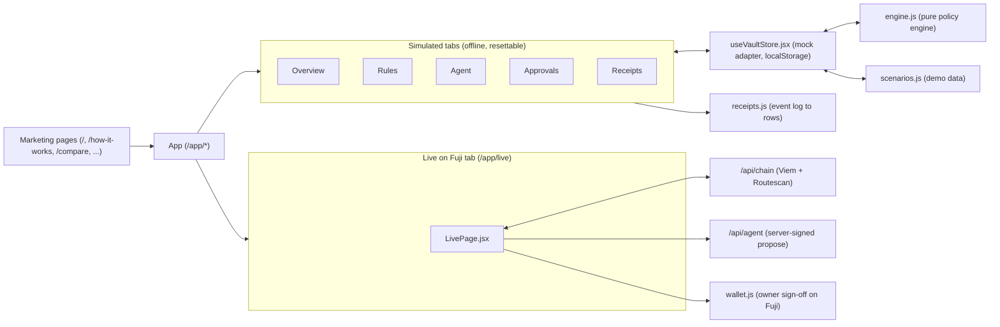

# System Patterns: Bounded

This document captures the architectural patterns, component relationships, data flows, and design invariants that govern Bounded.

---

## 1. High-Level Architecture & Data Flow

```mermaid
flowchart TD
    subgraph Owner["Vault Owner (Human)"]
        O_Deposit["deposit(token, amt) / withdraw(token, amt)"]
        O_Policy["setPolicy(Policy, allowlist[])"]
        O_Limits["setLimits(token, perTx, daily)"]
        O_Control["freeze() / unfreeze() / revokeAgent()"]
        O_Approve["approve(id) / reject(id)"]
    end

    subgraph Contract["BoundedVault.sol (On-Chain Authority)"]
        VaultState[("Vault State:
        - AVAX & ERC20 balances
        - policy (expiry, breakerThreshold, breakerWindow, version)
        - limits[token] (perTx, daily)
        - spent[token][utcDay]
        - _allowed[version][who]
        - requests[id]
        - frozen / blockCount / breakerBucket")]
        
        EvalEngine["_evaluate(token, to, amount) -> (Outcome, Reason)"]
        BreakerEngine["_recordBlock() -> Auto-Freezes if >= threshold"]
        SafeTransfer["_send(token, to, amount)
        Native AVAX or SafeERC20"]
    end

    subgraph Agent["AI Agent (Autonomous)"]
        A_Propose["propose(token, to, amount)"]
    end

    subgraph External["External World"]
        Recipient["Allowlisted Recipient (AVAX or ERC20)"]
    end

    subgraph Logs["Block Receipts (Immutable Audit Trail)"]
        L_Proposed["Proposed(id, token, to, amount, version)"]
        L_Decided["Decided(id, outcome, reason)"]
        L_Frozen["AgentFrozen(blockCount, window)"]
        L_Approved["Approved(id) / Rejected(id)"]
    end

    O_Deposit --> Contract
    O_Policy --> Contract
    O_Limits --> Contract
    O_Control --> Contract
    O_Approve --> Contract

    A_Propose --> L_Proposed
    A_Propose --> EvalEngine

    EvalEngine -->|Outcome.Auto: In-Policy| SafeTransfer
    SafeTransfer --> Recipient
    EvalEngine -->|Outcome.Auto| L_Decided

    EvalEngine -->|Outcome.Pending: Over-Limit| StagedRequest[Stage in requests[]]
    StagedRequest --> L_Decided

    EvalEngine -->|Outcome.Blocked: Policy Breach| BreakerEngine
    BreakerEngine --> L_Decided
    BreakerEngine -->|Threshold Exceeded| L_Frozen
```

---

## 2. Core Smart Contract Invariants

### Invariant 1: The Smart Contract is the Sole Authority
- **Zero Off-Chain Trust**: The contract never relies on oracles, off-chain agent signatures, or client-side assertions. 
- All rules (`_allowed[version]`, `limits[token]`, `policy.expiry`, `frozen`, `agent`) are evaluated deterministically at EVM execution time.
- The agent has no arbitrary transfer capabilities; it can only invoke `propose()`.

### Invariant 2: Non-Reverting Audit Logging for Agent Violations
- When an agent proposal violates safety rules (e.g. `amount > perTx`, `to` not allowlisted, vault paused/frozen, or insufficient balance), the contract **does not revert**.
- Instead, it emits `Decided(id, Outcome.Blocked, reason)` and records the event to the circuit breaker.
- *Rationale*: An EVM revert rolls back all state and log emissions. Emitting `Decided` in a successful transaction guarantees that every unauthorized or malicious attempt is immutably indexed in block receipts.

### Invariant 3: Automated Rate-Based Circuit Breaker
```solidity
function _recordBlock() internal {
    Policy memory p = policy;
    if (p.breakerThreshold == 0 || p.breakerWindow == 0) return;
    uint256 bucket = block.timestamp / p.breakerWindow;
    if (bucket != breakerBucket) {
        breakerBucket = bucket;
        blockCount = 0;
    }
    if (++blockCount >= p.breakerThreshold) {
        frozen = true;
        emit AgentFrozen(uint32(blockCount), p.breakerWindow);
    }
}
```
If an agent triggers repeated blocks (e.g. under prompt injection or bug loops), the vault automatically freezes the agent, halting further execution until the owner investigates and calls `unfreeze()`.

### Invariant 4: Atomic Policy Versioning & Stale Allowlist Eviction
- Every call to `setPolicy(Policy, allowlist[])` increments `policy.version`.
- Allowlist permissions are keyed by `_allowed[version][who] = true`.
- Updating a policy atomically invalidates all previous allowlist entries without requiring expensive array iterations or unbounded storage deletions.

### Invariant 5: Multi-Asset Unified Handling
- `token == address(0)` designates native AVAX; transfers use `to.call{value: amount}("")`.
- `token != address(0)` designates an ERC-20 token; transfers use `IERC20(token).safeTransfer(to, amount)`.
- ReentrancyGuard is applied to `propose`, `approve`, `deposit`, and `withdraw`.

### Invariant 6: Request Escalation State Machine
When an agent proposes an amount exceeding limits for an allowlisted address:
- Outcome is `Outcome.Pending`.
- Staged into `requests[]` with status `0 = Pending`.
- Owner approves (`approve(id)`) or rejects (`reject(id)`).
- **Replay Protection**: Status flips to `1` *before* initiating `_send`. Only `status == 0` can be approved or rejected.

### Invariant 7: Fail-Safe by Default
- On fresh contract deployment, `policy.expiry` is initialized to `0`.
- All agent proposals fail as `Reason.Expired` until the owner explicitly configures the initial policy.

### Invariant 8: Owner Sovereignty Invariant
- `withdraw`, `freeze`, `unfreeze`, and `reject` never depend on agent or policy state.
- Even if the agent is frozen, policy is expired, or breaker triggered, the owner can always withdraw funds, freeze/unfreeze, or dismiss pending proposals.

---

## 3. Frontend Architecture Patterns



### Dual-Mode App: Simulated + Live on Fuji
- **Simulated tabs** (`/app`, `/app/rules`, `/app/agent`, `/app/approvals`, `/app/receipts`): run on `src/lib/engine.js` with `localStorage` persistence so the normal-day and prompt-injection stories work offline and can be reset in one click.
- **Live on Fuji tab** (`/app/live`, `src/views/LivePage.jsx`): reads real contract state server-side via Viem (`/api/chain`) and contract events via Routescan, triggers real agent proposals via `/api/agent` (keeping `AGENT_PRIVATE_KEY` strictly on the server), and lets the owner sign `approve`, `reject`, `freeze`, `unfreeze`, `setPolicy`, and `withdraw` directly from a browser wallet (`src/lib/chain/wallet.js`).

### Pure engine, thin UI
- `src/lib/engine.js` returns new state for every transition and never mutates. The UI only renders its output.
- Every proposal yields exactly one `Decided` event. Summary numbers are computed from the event log, never hardcoded.

### No chat with the agent
- The Agent Console accepts only a strict proposal schema (`action`, `token`, `amount`, `destination`). Unknown fields, bad enums and non-positive amounts are rejected.
- Untrusted input (the market feed, including a poisoned item) is shown as data the agent reads, never as instructions to the vault.

### Tighten easy, loosen gated
- `diffPolicy` / `isLoosening` classify every rule change. Loosening opens a confirm dialog with the full before/after diff; tightening applies in one click. A shorter breaker window counts as loosening.

### Honesty as a test
- `tests/honesty.test.mjs` fails on banned claims, on the Bitget user figure without "company-reported", and on the brand name outside `src/lib/site.js`.
